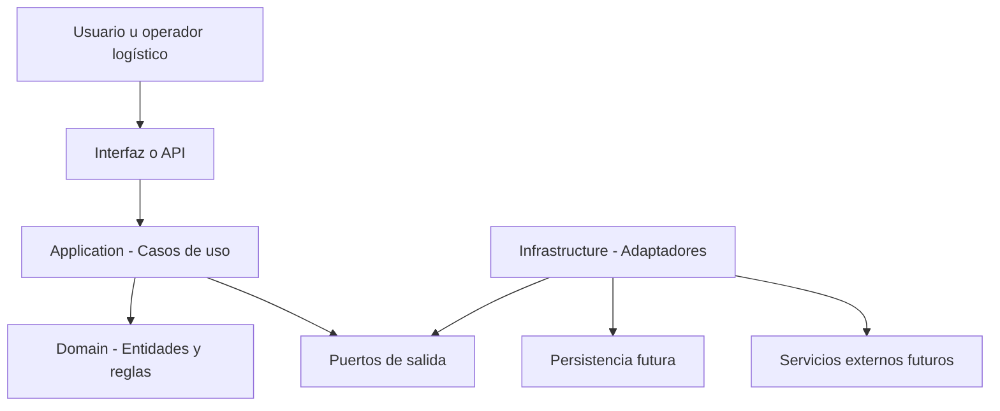
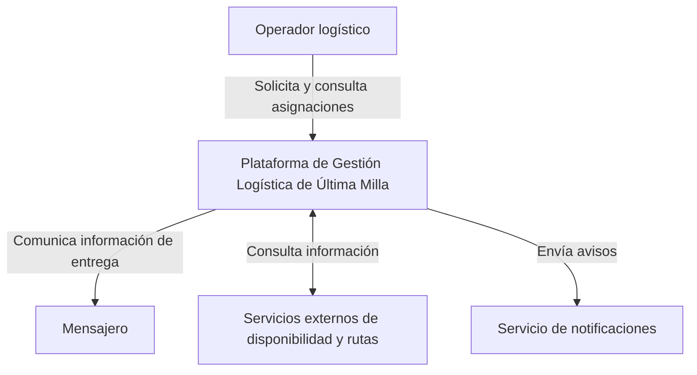
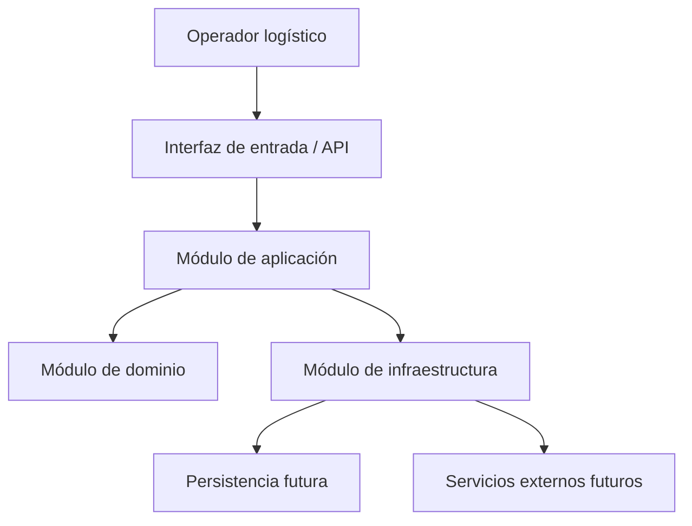
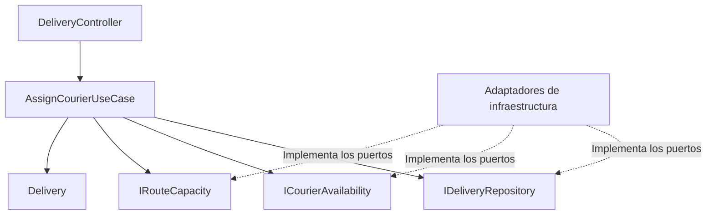

# Architecture - Plataforma de Gestión Logística de Última Milla

## 1. Introducción

Este documento describe la arquitectura propuesta para la Plataforma de Gestión Logística de Última Milla.

El propósito de la solución es organizar los procesos relacionados con la administración de pedidos, entregas, mensajeros y rutas, facilitando la coordinación de las operaciones logísticas.

La arquitectura se diseña teniendo en cuenta la separación de responsabilidades, la protección de las reglas del negocio y la posibilidad de ampliar la solución en futuras etapas.

## 2. Objetivos arquitectónicos

Los principales objetivos son:

- Separar las reglas del negocio de los detalles técnicos.
- Mantener una estructura organizada y fácil de mantener.
- Evitar que el dominio dependa directamente de bases de datos o servicios externos.
- Facilitar las pruebas de los casos de uso.
- Permitir futuras integraciones con servicios de disponibilidad, rutas y notificaciones.
- Mantener una solución que pueda evolucionar sin aumentar innecesariamente su complejidad.

## 3. Estilo arquitectónico

Se propone una arquitectura de monolito modular con separación en capas y aplicación del enfoque de puertos y adaptadores.

Se elige este estilo porque permite desarrollar los módulos dentro de una misma solución, manteniendo sus responsabilidades organizadas.

No se propone iniciar con microservicios, ya que para el alcance actual del proyecto no se considera necesario asumir la complejidad adicional de distribuir los componentes.

## 4. Organización de la solución

La estructura general del proyecto es:

```text
Actividad3_Dominio_Diseno/
│
├── README.md
├── Architecture.md
│
├── docs/
│   └── actividad-3/
│       ├── diagramas/
│       ├── flujo-negocio.md
│       ├── glosario-dominio.md
│       ├── modelo-dominio.md
│       ├── invariantes.md
│       ├── escenarios-aceptacion.md
│       ├── contextos-delimitados.md
│       ├── casos-uso-puertos-adaptadores.md
│       └── ADR-002-diseno-dominio.md
│
├── src/
│   ├── Domain/
│   │   ├── Entities/
│   │   ├── ValueObjects/
│   │   └── Enums/
│   │
│   ├── Application/
│   │   ├── UseCases/
│   │   ├── Ports/
│   │   └── DTOs/
│   │
│   └── Infrastructure/
│       ├── Persistence/
│       ├── Integrations/
│       └── Notifications/
│
└── tests/
    ├── Domain/
    └── Integration/
```

## 5. Descripción de las capas

### 5.1 Domain

Es el núcleo de la solución y contiene los elementos principales del negocio.

Responsabilidades:

- Definir las entidades.
- Representar los objetos de valor.
- Administrar los estados de las entregas.
- Proteger las reglas e invariantes del negocio.

Componentes principales:

- Delivery.
- Courier.
- Order.
- Assignment.
- DeliveryId.
- CourierId.
- DeliveryStatus.

Esta capa no debe depender de tecnologías de infraestructura.

### 5.2 Application

Contiene los casos de uso que coordinan las operaciones del sistema.

Responsabilidades:

- Recibir solicitudes.
- Coordinar las operaciones del dominio.
- Consultar los puertos necesarios.
- Gestionar los resultados de los casos de uso.
- Mantener la comunicación con las capacidades externas mediante contratos.

Caso de uso principal:

`AssignCourierUseCase`

Este caso de uso coordina la asignación de un mensajero a una entrega.

### 5.3 Infrastructure

Contiene los adaptadores técnicos que implementan los puertos definidos por la aplicación.

Responsabilidades futuras:

- Consultar y guardar información.
- Conectarse con servicios de disponibilidad.
- Consultar capacidad de rutas.
- Enviar notificaciones.
- Implementar los mecanismos técnicos de comunicación.

En la Actividad 3 se define esta estructura de manera conceptual. No se requiere implementar una base de datos real ni integraciones externas.

## 6. Modelo de dominio

La entidad principal es `Delivery`, porque representa la entrega que será administrada por la plataforma.

Se relaciona con:

- `Order`: pedido asociado a la entrega.
- `Courier`: mensajero responsable de realizarla.
- `Assignment`: registro de la asignación.

Los objetos de valor permiten representar identificadores, direcciones y estados de manera controlada.

La entidad `Delivery` protege las reglas relacionadas con su asignación y sus cambios de estado.

## 7. Flujo arquitectónico de asignación

El proceso de asignación se desarrolla de la siguiente manera:

1. El operador solicita asignar un mensajero.
2. La aplicación recibe la solicitud.
3. El caso de uso consulta la entrega.
4. Se verifica la disponibilidad del mensajero.
5. Se consulta la capacidad de la ruta cuando aplique.
6. El dominio valida las reglas de asignación.
7. La aplicación solicita guardar el resultado mediante el puerto correspondiente.
8. Se informa el resultado de la operación.

## 8. Diagrama de arquitectura por capas



## 9. Modelo C4

### 9.1 Nivel 1: Diagrama de contexto

La plataforma es el sistema central que permite administrar las operaciones logísticas.



### 9.2 Nivel 2: Diagrama de contenedores

La solución se organiza en módulos que trabajan dentro de una misma aplicación.



### 9.3 Nivel 3: Diagrama de componentes del proceso de asignación



## 10. Comunicación entre módulos

Se identifican cuatro contextos delimitados:

| Contexto | Responsabilidad |
|---|---|
| Order Management | Administración de pedidos. |
| Delivery Management | Administración y asignación de entregas. |
| Courier Management | Administración y disponibilidad de mensajeros. |
| Route Management | Organización y capacidad de rutas. |

Delivery Management coordina el proceso principal de asignación y utiliza la información necesaria de los demás contextos mediante contratos definidos.

## 11. Seguridad y validaciones

La arquitectura contempla la necesidad de validar:

- La identidad del operador.
- Los permisos para realizar asignaciones.
- La existencia de la entrega.
- La disponibilidad del mensajero.
- El estado de la entrega.
- La capacidad de la ruta cuando aplique.

La autorización de usuarios y las reglas de negocio deben mantenerse como responsabilidades diferenciadas.

## 12. Pruebas

Se proponen dos niveles principales de pruebas:

**Pruebas de dominio**

Permiten verificar las reglas de las entidades, los estados y las invariantes sin depender de infraestructura.

**Pruebas de integración**

En una etapa posterior permitirán comprobar la comunicación entre la aplicación y los adaptadores implementados.

Los escenarios de aceptación definidos en `escenarios-aceptacion.md` servirán como referencia para validar el comportamiento esperado.

## 13. Decisiones arquitectónicas

La decisión principal es mantener un monolito modular con separación en capas y puertos y adaptadores.

Esta decisión queda registrada en `ADR-002-diseno-dominio.md`.

Se busca que las reglas del negocio permanezcan independientes de las tecnologías utilizadas para almacenar información o comunicarse con servicios externos.

## 14. Alcance actual y evolución

En la Actividad 3 se documentan el diseño del dominio, las responsabilidades de las capas, los límites de los contextos, los casos de uso y los contratos de comunicación.

La implementación de persistencia, integraciones reales, autenticación y mecanismos de concurrencia se desarrollará en etapas posteriores, de acuerdo con los requisitos del proyecto.

## 15. Conclusión

La arquitectura propuesta proporciona una base organizada para la Plataforma de Gestión Logística de Última Milla.

La separación entre dominio, aplicación e infraestructura permite mantener las reglas del negocio protegidas, facilita las pruebas y prepara el sistema para futuras ampliaciones.

El diseño se centra en el proceso de asignación de mensajeros, estableciendo sus responsabilidades, restricciones y mecanismos de comunicación antes de implementar los detalles técnicos.