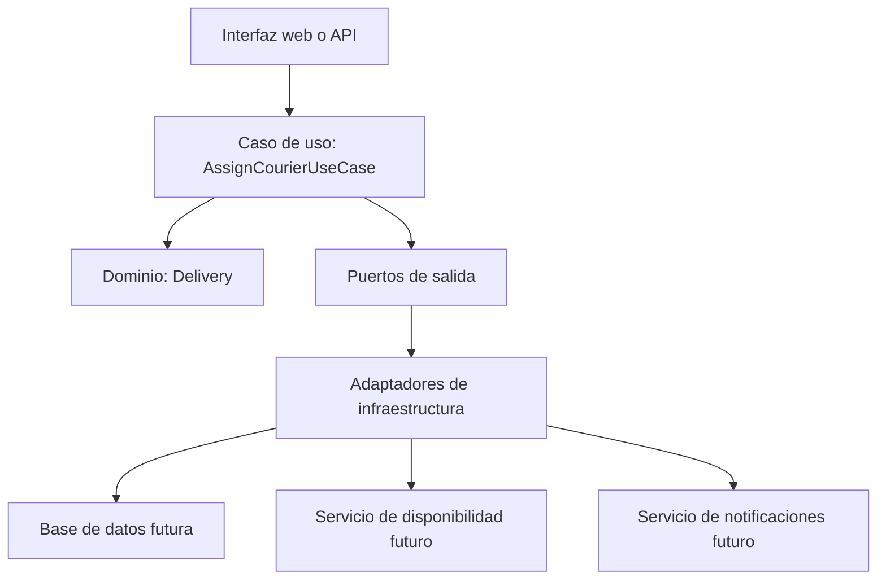
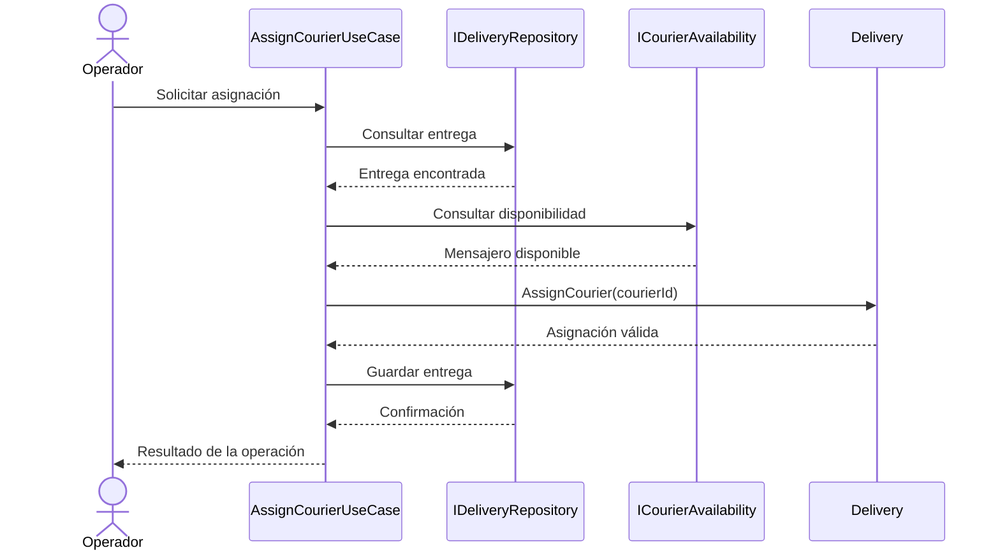

# Casos de uso, puertos y adaptadores

## 1. Objetivo

Definir cómo se realizará la asignación de un mensajero a una entrega dentro de la Plataforma de Gestión Logística de Última Milla.

El diseño utiliza una arquitectura basada en puertos y adaptadores para separar las reglas del negocio de los detalles técnicos, como las bases de datos, las API externas y los servicios de notificaciones.

El objetivo es que el dominio pueda funcionar sin depender directamente de tecnologías externas.

## 2. Caso de uso principal: asignar mensajero a una entrega

**Nombre:** AssignCourierUseCase.

**Actor principal:** Operador logístico.

**Objetivo:** Asignar un mensajero disponible a una entrega que se encuentre en estado pendiente.

**Precondiciones:**

- La entrega debe existir.
- La entrega debe estar en estado pendiente.
- La entrega no debe tener un mensajero asignado.
- El mensajero debe estar disponible.
- La ruta debe tener capacidad, cuando aplique.

**Resultado esperado:**

La entrega queda asociada al mensajero seleccionado y cambia su estado de pendiente a asignada.

## 3. Responsabilidades del caso de uso

El caso de uso `AssignCourierUseCase` coordina el proceso de asignación. Sus responsabilidades son:

1. Recibir la solicitud de asignación.
2. Consultar la entrega mediante el puerto de repositorio.
3. Verificar que la entrega exista.
4. Consultar la disponibilidad del mensajero.
5. Verificar la capacidad de la ruta, cuando corresponda.
6. Solicitar a la entidad Delivery que realice la asignación.
7. Guardar los cambios mediante el repositorio.
8. Informar que la asignación fue realizada correctamente.

El caso de uso coordina las operaciones, pero no reemplaza las reglas del dominio. Las reglas propias de la entrega se mantienen dentro de la entidad `Delivery`.

## 4. DTO de entrada

El caso de uso recibe los datos necesarios mediante un objeto de transferencia de datos.

**AssignCourierCommand**

| Campo | Descripción |
|---|---|
| DeliveryId | Identificador de la entrega. |
| CourierId | Identificador del mensajero que se desea asignar. |
| OperatorId | Identificador del operador que solicita la asignación. |

Estos datos permiten identificar la entrega, el mensajero y el usuario responsable de la operación.

## 5. Puertos de entrada

Los puertos de entrada representan las operaciones que la aplicación permite ejecutar.

| Puerto | Responsabilidad |
|---|---|
| IAssignCourierUseCase | Ejecutar el proceso de asignación de mensajero. |

El controlador de una API, una interfaz web o una aplicación de escritorio podrían invocar este caso de uso mediante el puerto de entrada.

## 6. Puertos de salida

Los puertos de salida representan las capacidades externas que necesita la aplicación para completar el proceso.

| Puerto | Responsabilidad |
|---|---|
| IDeliveryRepository | Consultar y guardar entregas. |
| ICourierAvailability | Consultar si un mensajero está disponible. |
| IRouteCapacity | Consultar si una ruta tiene capacidad disponible, cuando aplique. |
| IAssignmentNotifier | Informar que una asignación se realizó correctamente. |

La aplicación conoce las interfaces de estos puertos, pero no necesita conocer cómo funcionan internamente sus implementaciones.

## 7. Adaptadores propuestos

Los adaptadores implementan los puertos y permiten conectar la aplicación con elementos externos.

| Adaptador | Puerto que implementa | Función |
|---|---|---|
| DeliveryRepositoryAdapter | IDeliveryRepository | Consultar y guardar entregas. |
| CourierAvailabilityAdapter | ICourierAvailability | Consultar la disponibilidad del mensajero. |
| RouteCapacityAdapter | IRouteCapacity | Consultar la capacidad de una ruta. |
| AssignmentNotifierAdapter | IAssignmentNotifier | Enviar notificaciones de asignación. |
| DeliveryController | IAssignCourierUseCase | Recibir solicitudes y ejecutar el caso de uso. |

Estos adaptadores representan propuestas de diseño. En esta actividad no se requiere conectar una base de datos real ni implementar integraciones externas.

## 8. Ejemplo conceptual de contratos en C#

El siguiente código ilustra las interfaces que se podrían implementar en una etapa posterior del proyecto:

```csharp
public interface IAssignCourierUseCase
{
    Task ExecuteAsync(AssignCourierCommand command);
}

public interface IDeliveryRepository
{
    Task<Delivery?> GetByIdAsync(DeliveryId deliveryId);
    Task SaveAsync(Delivery delivery);
}

public interface ICourierAvailability
{
    Task<bool> IsAvailableAsync(CourierId courierId);
}

public interface IRouteCapacity
{
    Task<bool> HasCapacityAsync(DeliveryId deliveryId);
}

public interface IAssignmentNotifier
{
    Task NotifyAssignmentAsync(Delivery delivery);
}
```

Los contratos permiten definir qué necesita cada componente sin establecer todavía cómo se conectará con la infraestructura.

## 9. Dirección de las dependencias

La arquitectura establece las siguientes reglas:

- El dominio contiene las entidades, los objetos de valor y las reglas del negocio.
- La aplicación contiene los casos de uso y define los puertos que necesita.
- La infraestructura implementa los puertos mediante adaptadores.
- La infraestructura puede depender de la aplicación y del dominio.
- El dominio no debe depender de bases de datos, servicios web ni herramientas externas.



## 10. Secuencia del proceso de asignación



## 11. Manejo de errores

El caso de uso debe contemplar las siguientes situaciones:

- Entrega inexistente: no se puede realizar la asignación.
- Mensajero no disponible: se rechaza la solicitud.
- Entrega previamente asignada: se evita una segunda asignación activa.
- Entrega entregada o cancelada: no se permite asignar otro mensajero.
- Ruta sin capacidad: se rechaza la asignación cuando esta condición aplique.
- Error al guardar: se informa que la operación no pudo completarse.

Los errores deben comunicarse de manera clara para que el operador pueda conocer el motivo del rechazo.

## 12. Decisiones de diseño

Se propone mantener una arquitectura de monolito modular, organizada por responsabilidades y con separación entre dominio, aplicación e infraestructura.

Esta decisión permite desarrollar el sistema de manera ordenada sin introducir la complejidad de distribuir inicialmente la solución en varios microservicios.

El uso de puertos y adaptadores permite cambiar posteriormente la tecnología de persistencia o los servicios externos sin modificar las reglas centrales del negocio.

También se identifica como riesgo técnico la posibilidad de que dos operadores intenten asignar simultáneamente el mismo mensajero o la misma entrega. En una implementación posterior se deberá controlar esta situación mediante mecanismos de concurrencia y transacciones.

## 13. Alcance de esta actividad

En esta fase se documentan los casos de uso, los contratos, los puertos, los adaptadores y la dirección de las dependencias.

No se implementa todavía una base de datos real, una API externa de disponibilidad ni un servicio de notificaciones. Estas implementaciones corresponden a una etapa posterior del desarrollo.