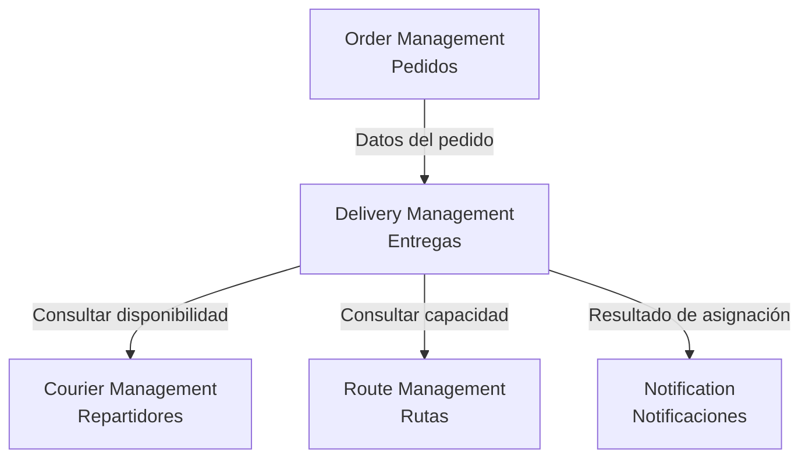

# Contextos delimitados – Plataforma de Gestión Logística de Última Milla

## 1. Objetivo

Identificar y delimitar los contextos principales que participan en la Plataforma de Gestión Logística de Última Milla, estableciendo sus responsabilidades y las relaciones necesarias para realizar el proceso de asignación de repartidores.

La separación por contextos permite organizar el dominio y evitar que las funcionalidades de diferentes procesos se mezclen.

## 2. Contextos identificados

Para el alcance inicial del proyecto se identifican cuatro contextos principales.

### 2.1. Contexto de pedidos (Order Management)

**Responsabilidad:**

Administrar la información de los pedidos realizados por los clientes.

**Información principal:**

- Identificador del pedido.
- Identificador del cliente.
- Productos solicitados.
- Estado del pedido.

**Funciones:**

- Registrar pedidos.
- Consultar pedidos.
- Consultar la información necesaria para preparar una entrega.
- Informar cuándo un pedido está listo para continuar con el proceso logístico.

**Límite del contexto:**

Este contexto administra los pedidos, pero no realiza directamente la asignación de repartidores.

### 2.2. Contexto de entregas (Delivery Management)

**Responsabilidad:**

Administrar las entregas asociadas a los pedidos y controlar su ciclo de vida.

**Información principal:**

- Identificador de entrega.
- Identificador del pedido.
- Dirección de entrega.
- Estado de entrega.
- Repartidor asignado.
- Fecha de asignación.

**Funciones:**

- Consultar entregas pendientes.
- Validar si una entrega puede recibir un repartidor.
- Ejecutar la asignación.
- Actualizar el estado de la entrega.
- Registrar el resultado de la asignación.

**Límite del contexto:**

Este es el contexto principal del flujo seleccionado. Protege las reglas relacionadas con la asignación y los estados de las entregas.

### 2.3. Contexto de repartidores (Courier Management)

**Responsabilidad:**

Administrar la información de los repartidores y consultar su disponibilidad.

**Información principal:**

- Identificador del repartidor.
- Nombre.
- Estado de disponibilidad.
- Capacidad de trabajo, cuando esté definida por el negocio.

**Funciones:**

- Consultar repartidores.
- Consultar disponibilidad.
- Informar si un repartidor puede recibir una nueva asignación.

**Límite del contexto:**

Este contexto administra la información de los repartidores, pero no modifica directamente las entregas.

### 2.4. Contexto de rutas (Route Management)

**Responsabilidad:**

Administrar la información de las rutas y su capacidad para atender entregas.

**Información principal:**

- Identificador de ruta.
- Recorrido.
- Entregas asociadas.
- Capacidad máxima definida.
- Estado de la ruta.

**Funciones:**

- Consultar rutas.
- Consultar capacidad disponible.
- Informar si una ruta puede recibir nuevas entregas.

**Límite del contexto:**

Este contexto administra las rutas y proporciona información para apoyar las decisiones de asignación.

## 3. Relaciones entre contextos

Los contextos se comunican mediante contratos definidos, evitando acceder directamente a las estructuras internas de otros contextos.

| Contexto de origen | Contexto de destino | Información intercambiada |
|---|---|---|
| Pedidos | Entregas | Identificador del pedido y datos necesarios para generar la entrega. |
| Entregas | Repartidores | Solicitud de consulta de disponibilidad de un repartidor. |
| Entregas | Rutas | Consulta de capacidad disponible de una ruta, cuando aplique. |
| Entregas | Notificaciones | Resultado de la asignación para informar a los usuarios correspondientes. |

## 4. Mapa de contextos

## 5. Contratos de comunicación

Para mantener separados los contextos se proponen los siguientes contratos:

### Contrato de pedidos

Permite obtener la información mínima del pedido necesaria para gestionar su entrega.

### Contrato de disponibilidad

Permite consultar si un repartidor puede recibir una nueva asignación.

### Contrato de capacidad de ruta

Permite verificar si la ruta cuenta con capacidad para atender una entrega adicional.

### Contrato de notificación

Permite comunicar el resultado de una asignación realizada correctamente o informar una novedad.

Estos contratos deben expresar necesidades del negocio y no depender de tecnologías específicas.

## 6. Reglas de comunicación

- Cada contexto debe ser responsable de sus propios datos y reglas.
- Un contexto no debe modificar directamente la información interna de otro.
- La comunicación debe realizarse mediante contratos definidos.
- El contexto de entregas coordina el flujo de asignación.
- La disponibilidad del repartidor debe consultarse sin depender directamente de un proveedor externo.
- Las integraciones concretas se implementarán en infraestructura.

## 7. Decisiones y límites del diseño

Para esta actividad se propone mantener separados conceptualmente los contextos, pero no se establece que cada uno deba convertirse en un microservicio independiente.

La decisión es mantener una solución organizada por módulos, coherente con la arquitectura monolítica modular seleccionada en la Actividad 2.

Esto permite conservar límites claros del negocio sin introducir complejidad innecesaria de comunicación entre servicios.

## 8. Conclusión

La delimitación de contextos permite identificar las responsabilidades de pedidos, entregas, repartidores y rutas.

El contexto de entregas coordina el flujo seleccionado y utiliza contratos para consultar la información que necesita de los demás contextos.

Esta separación facilita el mantenimiento, protege las reglas del negocio y prepara la solución para futuras modificaciones.