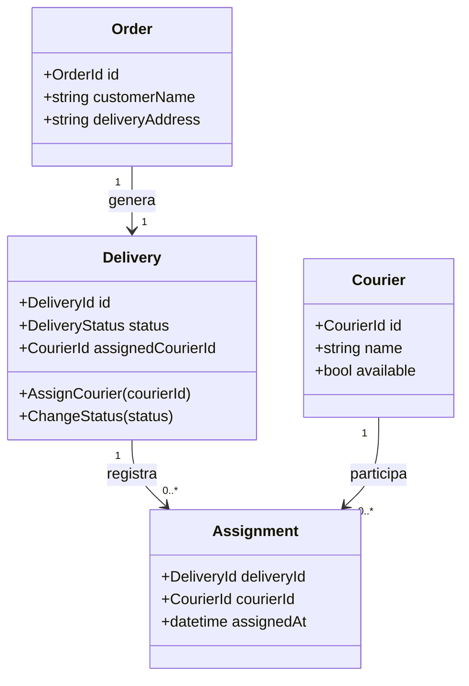
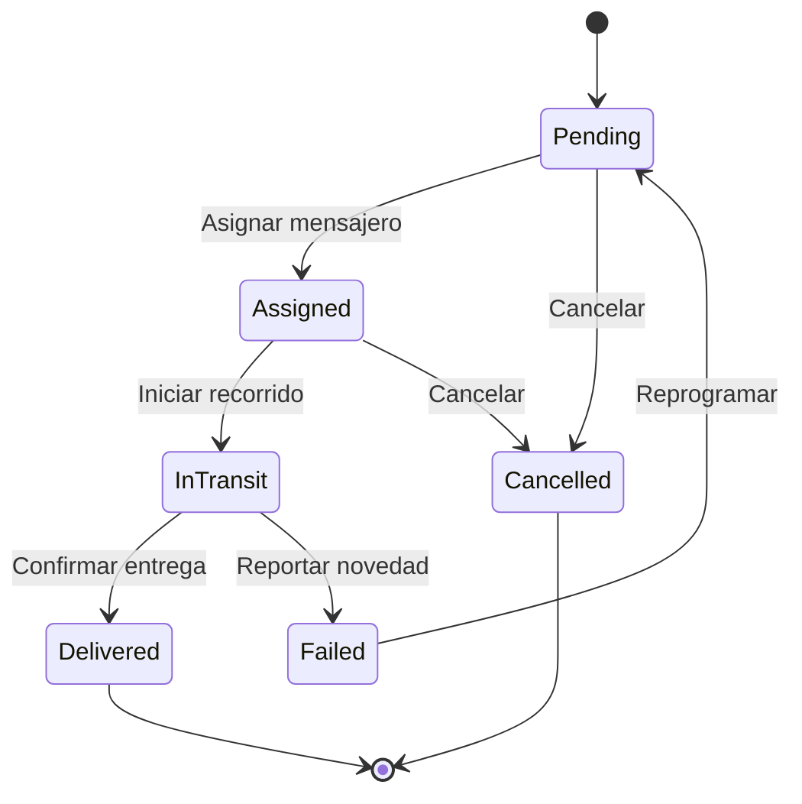
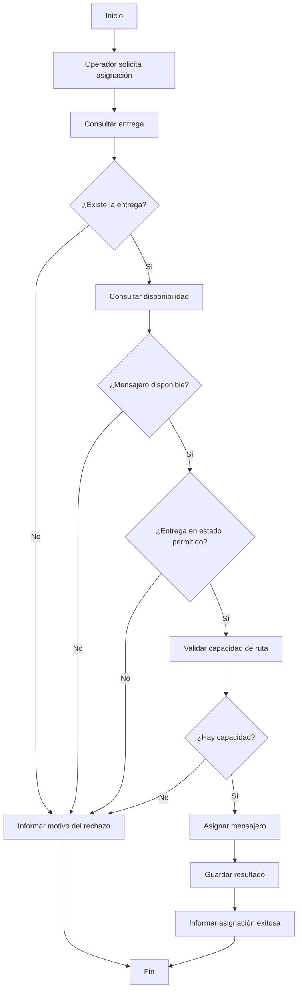
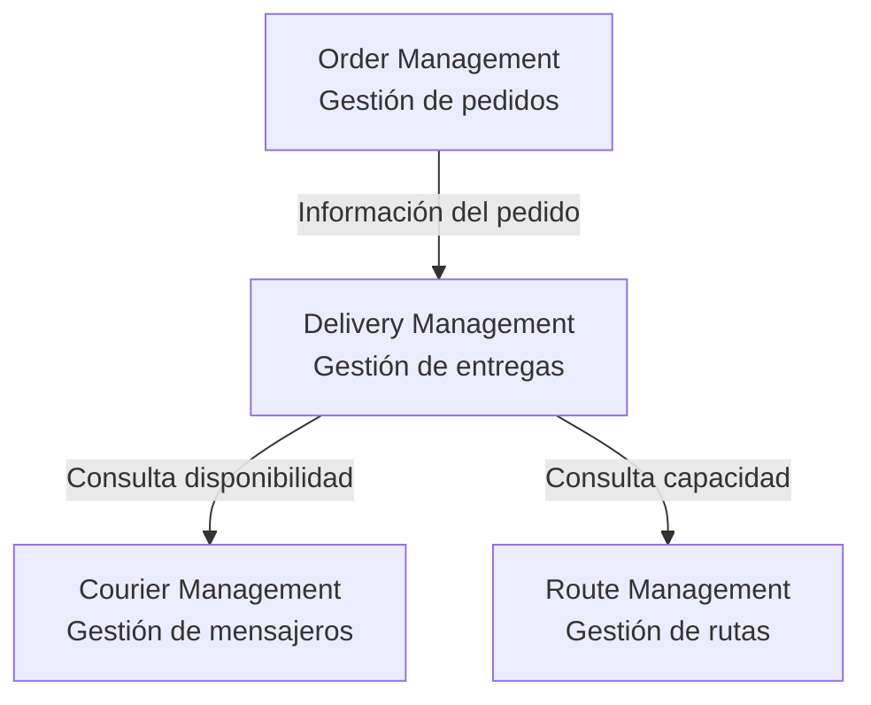
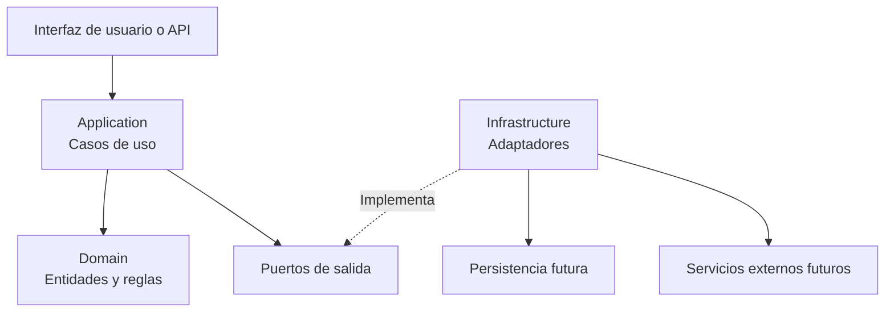
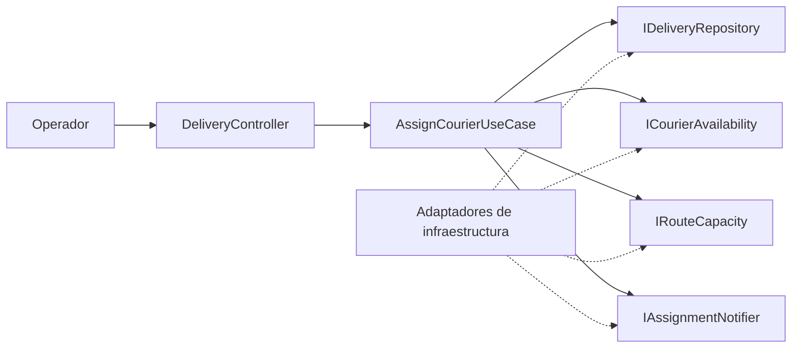
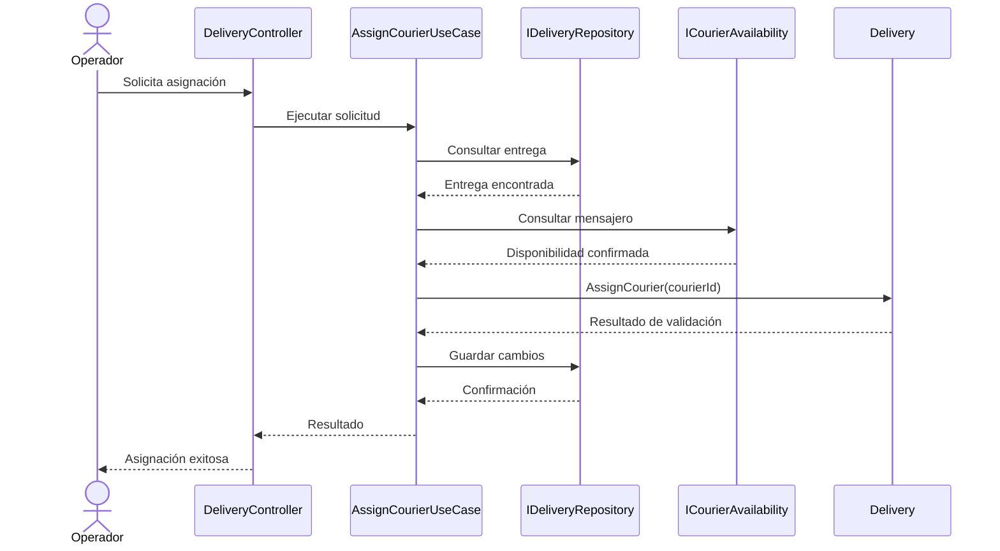
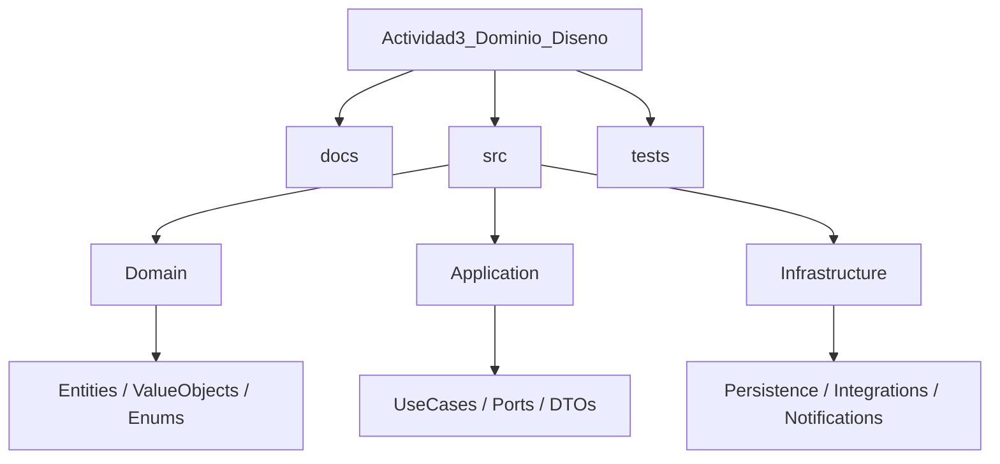

# Diagramas de dominio y arquitectura

**Proyecto:** Plataforma de Gestión Logística de Última Milla  
**Actividad:** Actividad 3 - Diseño y dominio

Este documento reúne los diagramas que representan el modelo de dominio, el proceso de asignación de mensajeros, los contextos delimitados y la arquitectura propuesta para la plataforma.

## 1. Diagrama del modelo de dominio

El modelo representa las entidades principales que participan en el proceso de gestión de entregas.

## 2. Diagrama de estados de una entrega

El siguiente diagrama representa los posibles estados de una entrega y sus transiciones principales.

## 3. Diagrama del flujo de negocio

Representa el proceso que realiza el operador para asignar un mensajero.

## 4. Diagrama de contextos delimitados

Se muestran los límites de responsabilidad de los principales contextos del negocio.

El contexto Delivery Management coordina el proceso de asignación y consulta la información que necesita de los demás contextos.

## 5. Diagrama de arquitectura por capas

Representa la separación entre dominio, aplicación e infraestructura.

## 6. Diagrama de puertos y adaptadores

Representa cómo el caso de uso se comunica con las capacidades externas mediante contratos.

## 7. Diagrama de secuencia de asignación

Describe el intercambio de mensajes durante la ejecución del caso de uso.

## 8. Diagrama de organización del proyecto

## 9. Conclusión

Los diagramas permiten visualizar cómo se organiza el dominio de la plataforma y cómo se relacionan sus componentes.

El diseño mantiene las reglas del negocio dentro del dominio, utiliza casos de uso para coordinar las operaciones y propone puertos y adaptadores para mantener separadas las responsabilidades técnicas.

Los diagramas representan la arquitectura propuesta para la Actividad 3. Las integraciones y los mecanismos de persistencia se desarrollarán en etapas posteriores.