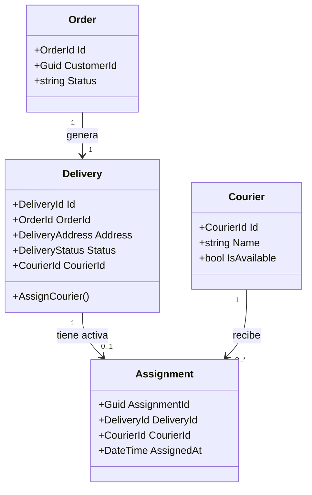

# Modelo de dominio – Plataforma de Gestión Logística de Última Milla

## 1. Objetivo

Definir los elementos principales del dominio para el proceso de asignación de repartidores a las entregas, identificando las entidades, los objetos de valor, los estados y las relaciones que permiten representar las reglas del negocio.

El modelo busca mantener las reglas principales protegidas dentro del dominio, evitando que dependan de tecnologías externas o mecanismos de persistencia.

## 2. Alcance del modelo

El modelo se concentra en el flujo de asignación de un repartidor a una entrega.

Se consideran los siguientes conceptos:

- Entrega.
- Repartidor.
- Pedido.
- Asignación.
- Dirección de entrega.
- Estado de entrega.
- Identificador de entrega.
- Identificador de repartidor.

## 3. Entidades del dominio

Las entidades tienen identidad propia y representan elementos que pueden cambiar durante el proceso logístico.

| Entidad | Identificador | Responsabilidad |
|---|---|---|
| Delivery (Entrega) | DeliveryId | Representa una entrega y controla su estado y la asignación de un repartidor. |
| Courier (Repartidor) | CourierId | Representa a la persona responsable de realizar las entregas y su disponibilidad. |
| Order (Pedido) | OrderId | Representa el pedido asociado a una entrega. |
| Assignment (Asignación) | AssignmentId | Representa la relación de asignación entre una entrega y un repartidor, cuando se requiera mantener un historial de asignaciones. |

### 3.1. Entidad Delivery

Es la entidad principal del flujo seleccionado.

Sus atributos principales son:

- Identificador de entrega.
- Identificador del pedido asociado.
- Dirección de entrega.
- Estado de entrega.
- Identificador del repartidor asignado, cuando exista.
- Fecha de creación.
- Fecha de asignación, cuando corresponda.

Sus responsabilidades son:

- Mantener la información de la entrega.
- Controlar su estado.
- Validar si puede recibir una asignación.
- Asociar un repartidor cuando se cumplen las reglas del negocio.
- Evitar que una entrega tenga dos repartidores activos asignados.

### 3.2. Entidad Courier

Representa al repartidor encargado de realizar las entregas.

Sus atributos principales son:

- Identificador del repartidor.
- Nombre.
- Estado de disponibilidad.
- Capacidad máxima de entregas, si el negocio la define.

Sus responsabilidades son:

- Identificar al repartidor.
- Representar su disponibilidad.
- Permitir verificar si puede recibir una nueva asignación.

La consulta de disponibilidad puede obtenerse mediante un puerto de aplicación, sin depender directamente de una API externa.

### 3.3. Entidad Order

Representa el pedido realizado por un cliente.

Sus atributos principales son:

- Identificador del pedido.
- Identificador del cliente.
- Productos solicitados.
- Estado del pedido.

Para el flujo seleccionado, el pedido proporciona el contexto de la entrega, pero no se modifican sus reglas internas.

### 3.4. Entidad Assignment

Representa la asignación de un repartidor a una entrega.

Puede contener:

- Identificador de asignación.
- Identificador de entrega.
- Identificador de repartidor.
- Fecha y hora de asignación.
- Estado de la asignación.

Esta entidad permite conservar información histórica cuando el negocio requiera registrar cambios o reasignaciones.

## 4. Objetos de valor

Los objetos de valor representan conceptos definidos por sus atributos. No tienen identidad independiente.

| Objeto de valor | Atributos | Descripción |
|---|---|---|
| DeliveryId | Guid Value | Identifica una entrega. |
| CourierId | Guid Value | Identifica a un repartidor. |
| OrderId | Guid Value | Identifica un pedido. |
| DeliveryAddress | String Value | Representa la dirección donde debe realizarse la entrega. |
| DeliveryStatus | Valor de estado | Representa la situación actual de la entrega. |
| AssignmentDate | DateTime Value | Representa el momento en que se realizó la asignación. |

Los identificadores se modelan como objetos de valor para evitar confusiones entre los diferentes tipos de identificadores.

## 5. Estados de una entrega

Para representar el proceso logístico se proponen los siguientes estados:

| Estado | Descripción |
|---|---|
| Pending | La entrega está registrada y pendiente de asignación. |
| Assigned | La entrega tiene un repartidor asignado. |
| InTransit | El repartidor inició el proceso de entrega. |
| Delivered | El pedido fue entregado al cliente. |
| Failed | La entrega no pudo completarse. |
| Cancelled | La entrega fue cancelada mediante un proceso autorizado. |

## 6. Transiciones de estado

Las transiciones representan los cambios permitidos durante el ciclo de vida de una entrega.

| Estado inicial | Evento | Estado final |
|---|---|---|
| Pending | Asignar repartidor correctamente | Assigned |
| Assigned | Iniciar recorrido de entrega | InTransit |
| InTransit | Confirmar entrega exitosa | Delivered |
| InTransit | Registrar entrega fallida | Failed |
| Pending | Cancelar entrega | Cancelled |
| Assigned | Cancelar mediante proceso autorizado | Cancelled |

Una entrega finalizada o cancelada no debe recibir una nueva asignación como si estuviera pendiente.

Las transiciones deben validarse dentro del dominio antes de modificar el estado.

## 7. Relaciones entre entidades

- Un pedido puede estar asociado a una entrega.
- Una entrega corresponde a un pedido.
- Una entrega puede tener una asignación activa.
- Una asignación relaciona una entrega con un repartidor.
- Un repartidor puede participar en varias entregas, de acuerdo con su disponibilidad y capacidad.
- Una entrega tiene una dirección de destino.
- El estado pertenece al ciclo de vida de la entrega.

## 8. Mapa conceptual del dominio

## 9. Protección de las reglas del dominio

La entidad Delivery debe proteger las reglas relacionadas con la asignación.

Por ejemplo, el método `AssignCourier(courierId)` debe comprobar que la entrega no tenga un repartidor activo asignado y que se encuentre en un estado permitido.

La entidad no debe consultar directamente una base de datos, realizar solicitudes HTTP ni depender de un framework.

Las consultas de disponibilidad corresponden a la coordinación del caso de uso mediante un puerto definido en la capa de aplicación.

## 10. Conclusión

El modelo de dominio permite representar los conceptos principales del proceso de asignación de repartidores y establecer las responsabilidades de cada entidad.

La entidad Delivery es el elemento central del flujo porque protege las reglas de asignación y controla las transiciones de estado.

La separación entre entidades y objetos de valor permite mantener un modelo organizado, comprensible y preparado para una implementación posterior.